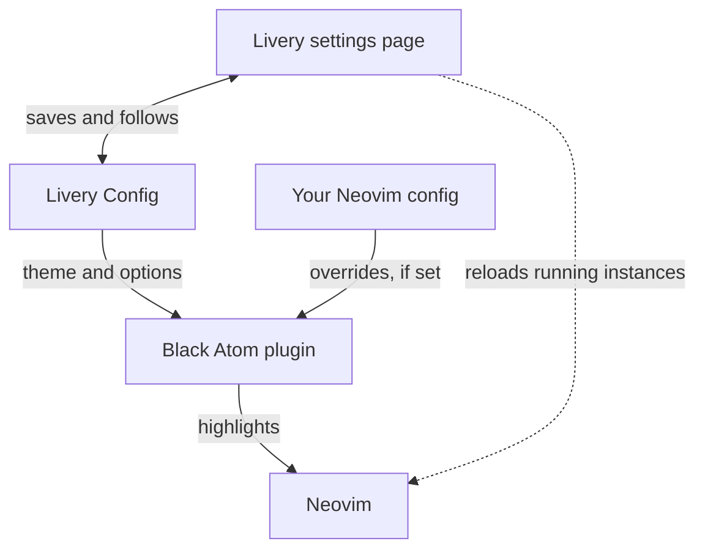

# Black Atom for Neovim

The Black Atom themes for Neovim. The colors are defined once in [`core/`](../../core/) and generated here, so they match every other Black Atom tool.

## Themes

All Black Atom themes are included. [`catalog.ts`](../../core/src/themes/catalog.ts) lists them.

## Installation

Each theme is a normal colorscheme, named `black-atom-<collection>-<name>`. Press tab after `:colorscheme black-atom-` to see them all.

### Without Livery

Install it with your plugin manager, then set a colorscheme. The adapter is a subdirectory of the Black Atom repository, so the manager clones the whole repository and you add `adapters/nvim` to the runtimepath.

With [lazy.nvim](https://github.com/folke/lazy.nvim):

```lua
{
    "black-atom-industries/black-atom",
    lazy = false,
    priority = 1000,
    config = function(plugin)
        vim.opt.rtp:prepend(plugin.dir .. "/adapters/nvim")
        vim.cmd.colorscheme("black-atom-jpn-koyo-dark")
    end,
}
```

With `vim.pack`:

```lua
vim.pack.add({ "https://github.com/black-atom-industries/black-atom" })
vim.opt.rtp:prepend(vim.fn.stdpath("data") .. "/site/pack/core/opt/black-atom/adapters/nvim")
vim.cmd.colorscheme("black-atom-jpn-koyo-dark")
```

To change options, set your [config table](#configuration) before the `:colorscheme` call.

### With Livery

[Livery](../../livery/) installs the adapter and stores your theme and options in its `config.json`. Neovim opens in your theme without any config of its own. Livery never edits your Neovim files.

**Changes apply live.** Save an option or pick a theme in Livery, and every running Neovim updates right away. You don't restart anything or run a command.



- **Startup:** the plugin applies Livery's theme, unless your config already set a colorscheme. A theme name it can't load gives a warning.
- **Switching themes:** every running Neovim changes to the new theme.
- **Changing options:** every running Neovim on a Black Atom theme reloads that theme. Other colorschemes aren't touched.
- **Your own settings:** if your config sets `vim.g.black_atom_core_config`, the settings page turns read-only and shows the file and line. If your config sets a fixed `:colorscheme`, the page shows a note. Livery finds these by searching the `.lua` and `.vim` files in `$XDG_CONFIG_HOME/nvim`, so it can occasionally match the wrong line.
- **Turning it off:** set `apps.nvim.enabled = false` in `config.json`. The plugin then ignores that file.

## Configuration

There is no `setup()`. Options come from three places. Each one overrides the one before it, key by key:

1. The defaults in `lua/black-atom/config.lua`.
2. `apps.nvim.settings` in Livery's config, `$XDG_CONFIG_HOME/black-atom/livery/config.json` (or `~/.config/black-atom/livery/config.json`).
3. `vim.g.black_atom_core_config` in your Neovim config.

Only set the keys you want to change:

```lua
vim.g.black_atom_core_config = {
    dark_gutter = true,
}
```

Set this in `init.lua` to have it apply at startup. If you set it later, it applies at the next `:colorscheme`.

All options, which use the same keys in `vim.g.black_atom_core_config` and `apps.nvim.settings`:

| Option                   | Values                          | Default              | What it does                                                                              |
| ------------------------ | ------------------------------- | -------------------- | ----------------------------------------------------------------------------------------- |
| `term_colors`            | boolean                         | `true`               | Sets the 16 terminal colors for `:terminal`.                                              |
| `transparency`           | `"none"`, `"partial"`, `"full"` | `"none"`             | `partial` removes the editor background. `full` also removes it from sidebars and floats. |
| `ending_tildes`          | boolean                         | `false`              | Shows `~` on the empty lines after a buffer ends.                                         |
| `cmp_kind_color_mode`    | `"fg"`, `"bg"`                  | `"bg"`               | Colors a completion kind's text or its background, in `nvim-cmp` and `blink.cmp`.         |
| `dark_sidebars`          | boolean                         | `true`               | Gives sidebars the darker panel background.                                               |
| `dark_floats`            | boolean                         | `true`               | Gives floating windows and popups the darker panel background.                            |
| `dark_gutter`            | boolean                         | `false`              | Gives the line number, sign and fold columns the darker panel background.                 |
| `gutter_padding`         | number of cells                 | `0`                  | Adds space between a dark gutter and the code. See [Gutter padding](#gutter-padding).     |
| `diagnostics.undercurl`  | boolean                         | `false`              | Uses a curly underline for diagnostics.                                                   |
| `diagnostics.background` | boolean                         | `false`              | Adds a background behind diagnostic virtual text.                                         |
| `syntax.comments`        | highlight attributes            | `{ italic = true }`  | Styles comments.                                                                          |
| `syntax.keywords`        | highlight attributes            | `{ bold = true }`    | Styles keywords.                                                                          |
| `syntax.functions`       | highlight attributes            | `{}`                 | Styles functions.                                                                         |
| `syntax.strings`         | highlight attributes            | `{ italic = false }` | Styles strings.                                                                           |
| `syntax.variables`       | highlight attributes            | `{}`                 | Styles variables.                                                                         |
| `syntax.messages`        | highlight attributes            | `{ bold = true }`    | Styles messages, such as errors and warnings.                                             |

### Syntax attributes

A `syntax` group takes any highlight attribute, such as `bold`, `italic` or `underline`.

Some highlights have attributes built in, such as the bold on `@function.call`. To remove one, set it to `false` in your own table. In `config.json`, `false` only works for attributes the group sets by default.

### Changing options at runtime

Change the table or `config.json`, then run `:colorscheme` again. Turning `term_colors` off only affects new Neovims.

### Gutter padding

A dark gutter sits right against the code. `gutter_padding` adds blank cells between them. Set `dark_gutter = true` and a padding above 0, and the plugin sets up `statuscolumn` for you.

If you set `statuscolumn` yourself, the plugin leaves it alone. Wrap your format in `pad` to get the padding:

```lua
function _G.MyStatuscolumn()
    return require("black-atom.gutter").pad("%C%s%=%l ")
end

vim.o.statuscolumn = "%!v:lua.MyStatuscolumn()"
```

Windows with their own `statuscolumn`, such as iter.nvim's diff views, get no padding.

## LSP completion

Each LSP completion kind has an `LspKind` highlight group, such as `LspKindFunction`.

- `nvim-cmp` and `blink.cmp` work without any setup.
- `mini.completion` needs a `process_items` callback that sets each item's `kind_hlgroup` to `LspKind<Kind>`.

## Plugins

Supported plugins each have a file in [`lua/black-atom/highlights/plugins/`](lua/black-atom/highlights/plugins/).

## Development

### Roadmap

See the [issues labeled `adapter:nvim`](https://github.com/black-atom-industries/black-atom/issues?q=is%3Aissue%20state%3Aopen%20label%3Aadapter%3Anvim).

### Tooling

Install the tools with [mise](https://mise.jdx.dev):

```bash
mise install      # lua, lua-language-server, stylua
mise run setup    # luacheck (via luarocks)
```

`luacheck` needs its own step because it has no prebuilt binary. Building it needs a C compiler (Xcode Command Line Tools on macOS). Run `mise run setup` again when you change the pinned Lua version.

### Building and Testing

Run all checks, the same ones CI runs:

```bash
mise run check
```

Or run one at a time: `mise run lint`, `mise run typecheck`, `mise run fmt-check`. `mise run fmt` formats the files.

### Working with Templates

Theme files are generated from a template, and you need [Node.js](https://nodejs.org/) 24+.

1. Edit `templates/collection.template.lua`.
2. Generate the theme files:
    ```bash
    node ../../core/src/cli/index.ts generate
    ```
3. Or regenerate on every change:
    ```bash
    node ../../core/src/cli/index.ts generate --watch
    ```

## License

MIT - See [LICENSE](./LICENSE) for details
