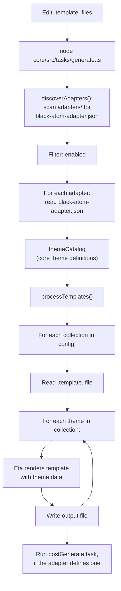

# Adapter guide

How themes reach a tool: the generation pipeline, the adapter config, the templates, and what a template may read. To
wire one tool by hand, read that tool's `adapters/<name>/README.md`. For the tool's side in Livery, read
[`livery/ADAPTERS.md`](../livery/ADAPTERS.md). For the token model, read [`colors.md`](colors.md).

## Pipeline

Core is the source of truth. Each adapter under `adapters/<name>/` declares which collections it renders and which
templates render them. Core runs from source, in this monorepo, never as a fetched package.



## Tasks

Run these from the repo root:

| Command                           | What it does                                                            |
| --------------------------------- | ----------------------------------------------------------------------- |
| `npm run generate`                | Regenerates every adapter once.                                         |
| `npm run dev`                     | Watches core and every adapter's templates, regenerates, and reapplies. |
| `npm run contrast <key>`          | Lists the Contrast Pairs of one theme with their WCAG ratios.           |
| `npm run --workspace core schema` | Regenerates `core/adapter.schema.json`.                                 |

Inside one adapter directory, `node ../../core/src/cli/index.ts generate` renders that adapter only. Add `--watch` to keep
rendering on change.

`npm run dev` applies themes to the real configs of the machine it runs on. An agent run uses a temporary fixture home
instead, as [`AGENTS.md`](../AGENTS.md) describes.

## Adapter config

Each adapter has a `black-atom-adapter.json`. Core discovers adapters through this file, and it skips any adapter with
`"enabled": false`.

```jsonc
{
    "$schema": "../../core/adapter.schema.json",
    "postGenerate": "node scripts/postGenerate.ts",
    "collections": {
        "jpn": {
            "template": "./themes/jpn/collection.template.json",
            "output": "./themes/jpn",
            "themes": ["black-atom-jpn-koyo-dark", "black-atom-jpn-koyo-light"],
        },
    },
}
```

- `collections` maps a collection key to its template and its themes. The keys and the theme keys are checked against
  `core/adapter.schema.json`, which lists the collection keys and theme keys from the code. Regenerate it after the
  collections change.
- `template` is one path or a list of paths. Each path renders its own file per theme.
- `output` is a directory, relative to the adapter, that receives the generated files. Without it, files land next to
  the template.
- `postGenerate` is an optional command. Core runs it in the adapter directory after every file is written. Use it when
  the adapter assembles output beyond a one-to-one render: Obsidian builds one `theme.css` this way.

## Templates and output names

Templates use [Eta](https://eta.js.org/). Write a variable as `<%= theme.ui.bg.default %>`.

The output name comes from the template's file name. Core removes `.template.` from it, then replaces `collection` with the
theme key. `themes/collection.template.lua` renders `themes/black-atom-jpn-koyo-dark.lua` for that theme. A template whose
file name has no `collection` writes every theme to the same path, so keep the word in the name.

## What a template may read

Templates read `theme.meta`, `theme.ui`, `theme.syntax` and `theme.palette`. The types are in
`core/src/types/theme.ts`.

Templates do not read `theme.feedback`. Feedback reaches a tool through the UI status tokens it feeds (see the table in
[`colors.md`](colors.md#feedback-function)).

Templates do not read `theme.primaries` either, with one exception. A target that defines its own ramp reads the primaries
to build it. Neovim's colorscheme template and Obsidian's collection templates do this. Every other template uses UI,
syntax and palette tokens, which keeps the adapter stable when the internals of the color groups change.

## Shared and copied templates

A single shared template can serve several collections, with `output` sending each collection to its own directory. Some
adapters keep one template per collection under `themes/<collection>/` instead, as lazygit, niri, obsidian, tmux, wezterm
and zed do. Each copy is a full template of its own, so a change to one usually belongs in every copy of that adapter.

## Package

Core is the private workspace package `@black-atom/core`, at `core/`. Its `package.json` exports three entries:

| Export                      | Entrypoint                          |
| --------------------------- | ----------------------------------- |
| `@black-atom/core`          | `core/src/mod.ts`                   |
| `@black-atom/core/contrast` | `core/src/lib/contrast-analysis.ts` |
| `@black-atom/core/cli`      | `core/src/cli/index.ts`             |

Nothing is published. The package is private, and the adapters use it from source.

## Generated files

Generated files are never edited by hand. Change the template or the theme, then regenerate. Commit the template and its
generated output together.

## Testing a template

1. Run `npm run generate`.
2. Open one generated file per theme, and check that its paths and values are the ones the template intends.
3. Load the file in the target tool, and check the result by eye against the theme's intent.
4. Run `npm run check` and `npm run test` from the repo root.
